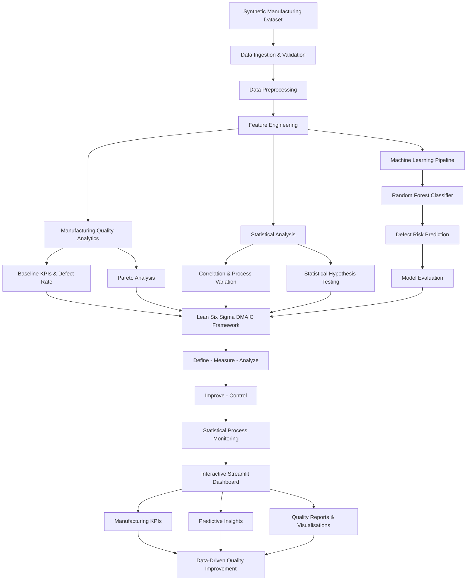

# Smart Manufacturing Analytics

## Toyota Manufacturing Process Improvement Using Lean Six Sigma and Machine Learning

An AI-driven manufacturing quality analytics project that integrates **Lean Six Sigma (DMAIC), statistical process analysis, and machine learning** to investigate process variation, identify potential defect-related patterns, and support data-driven manufacturing quality improvement. The system combines manufacturing data preprocessing, quality KPI analysis, Pareto analysis, Random Forest defect-risk classification, and statistical process monitoring. An interactive Streamlit dashboard presents manufacturing performance indicators, predictive insights, and process quality visualisations.

> **Important Data Disclaimer:** This project uses a synthetically generated manufacturing dataset. It is an educational Toyota-inspired case study, not an analysis of actual Toyota factory records or production systems. Any claims about Toyota-specific defects, operational savings, manufacturing improvements, or process performance would require authorised factory data and independent validation.

## Project Objectives

- Apply Lean Six Sigma principles to a simulated manufacturing quality improvement problem.
- Structure process analysis using the DMAIC methodology.
- Measure baseline manufacturing quality and defect-related KPIs.
- Explore relationships between operational variables and defect occurrence.
- Develop a machine-learning model for experimental defect-risk classification.
- Visualise manufacturing quality trends and process variation.
- Demonstrate how statistical analysis and predictive modelling can complement continuous improvement practices.

## Key Features

- **Synthetic Manufacturing Dataset:** Generates reproducible production records containing operational and quality measurements.
- **Data Validation and Preprocessing:** Checks data consistency, missing values, numerical ranges, and categorical variables.
- **Lean Six Sigma DMAIC Framework:** Organises quality improvement analysis into Define, Measure, Analyze, Improve, and Control stages.
- **Manufacturing Quality Analytics:** Calculates defect rates and process performance summaries.
- **Pareto Analysis:** Identifies the most frequently occurring defect-related categories or contributing factors represented in the dataset.
- **Machine Learning Classification:** Uses Random Forest to estimate synthetic manufacturing defect risk.
- **Statistical Process Monitoring:** Examines daily defect proportions using illustrative p-chart calculations.
- **Model Evaluation:** Reports classification metrics and predictive performance.
- **Interactive Dashboard:** Presents quality KPIs, process distributions, defect patterns, and model results through Streamlit.
- **Project Documentation:** Includes methodology, architecture, notebook, report, presentation, and analytical outputs.

## System Architecture

The proposed architecture integrates manufacturing data processing, statistical quality analysis, machine learning, and Lean Six Sigma methodology into a unified manufacturing intelligence workflow.

### Architecture Diagram



### Architecture Components

| Component | Function |
|---|---|
| Data Ingestion | Loads synthetic manufacturing production records. |
| Data Preprocessing | Validates, cleans, and prepares manufacturing data. |
| Feature Engineering | Extracts relevant operational and production features. |
| Quality Analytics | Calculates defect rates, production KPIs, and Pareto analysis. |
| Statistical Analysis | Examines correlations, process variation, and statistical patterns. |
| Machine Learning | Uses Random Forest for experimental defect-risk classification. |
| Model Evaluation | Measures predictive performance using classification metrics. |
| DMAIC Framework | Organises the quality improvement process into five stages. |
| Process Monitoring | Applies illustrative p-chart calculations to monitor defect proportions. |
| Streamlit Dashboard | Presents manufacturing insights, predictions, and quality visualisations. |

### Overall Workflow

1. **Data Collection and Generation:** Generate synthetic manufacturing production records.
2. **Data Preparation:** Perform data validation, preprocessing, and feature engineering.
3. **Quality and Statistical Analysis:** Calculate quality KPIs, perform Pareto analysis, and examine process variation.
4. **Predictive Modelling:** Train and evaluate the Random Forest defect classification model.
5. **DMAIC-Based Improvement:** Organise analytical findings through Define, Measure, Analyze, Improve, and Control.
6. **Monitoring and Visualisation:** Present process monitoring results, predictive insights, and quality reports through the Streamlit dashboard.

## Lean Six Sigma DMAIC Methodology

The project follows the five-stage DMAIC framework to organise manufacturing quality improvement analysis.

### 1. Define

Establish the manufacturing quality problem, project scope, and improvement objectives.

**Activities:**
- Define the simulated manufacturing defect problem.
- Identify relevant stakeholders and process boundaries.
- Establish Critical-to-Quality (CTQ) characteristics.
- Develop a SIPOC process overview.
- Define measurable quality improvement objectives.
- Prepare a project charter.

**Expected output:** A clearly defined manufacturing quality problem and analytical scope.

### 2. Measure

Establish baseline process performance using available manufacturing measurements.

**Activities:**
- Validate manufacturing data.
- Define defect and non-defect observations.
- Calculate baseline defect rates.
- Examine process variable distributions.
- Assess missing values and data consistency.
- Summarise operational KPIs.

**Key indicators:**

| KPI | Description |
|---|---|
| Total Production Records | Number of analysed production observations |
| Defective Records | Number of observations labelled defective |
| Defect Rate | Percentage of defective observations |
| Average Cycle Time | Mean manufacturing cycle duration |
| Average Temperature | Mean recorded process temperature |
| Average Pressure | Mean recorded process pressure |
| Average Vibration | Mean recorded vibration level |

**Defect Rate:**

\[
Defect\ Rate =
\frac{Defective\ Units}{Total\ Units}\times100
\]

This calculation assumes each observation represents one inspected unit with a binary defect outcome.

### 3. Analyze

Investigate process variation and potential factors associated with defects.

**Analytical techniques:**
- Exploratory data analysis
- Pareto analysis
- Process variable distributions
- Correlation analysis
- Shift-wise and machine-wise comparisons
- Statistical hypothesis testing, where assumptions are satisfied
- Machine-learning-based defect classification
- Feature importance analysis

The objective is to identify patterns worth investigating rather than claim that statistical associations prove manufacturing root causes.

### 4. Improve

Translate analytical observations into proposed improvement opportunities.

**Potential improvement areas:**
- Process parameter review
- Preventive maintenance planning
- Tool wear monitoring
- Operator training and standardisation
- Process variability reduction
- Manufacturing quality inspection improvements

**Validation requirements:**

Any proposed improvement should be reviewed by manufacturing specialists, tested through an approved pilot, and evaluated using suitable before-and-after measurements.

The synthetic demonstration does not establish that actual manufacturing improvements have occurred.

### 5. Control

Demonstrate how process performance could be monitored after validated improvements.

**Control activities:**
- Daily defect-rate monitoring
- Statistical process control charts
- KPI ownership and reporting
- Standard operating procedure review
- Periodic quality audits
- Defined escalation and reaction plans

The project includes illustrative defect-proportion monitoring to demonstrate the statistical process control concept.

## Manufacturing Dataset

The project uses a synthetic manufacturing dataset containing simulated production measurements and binary defect labels.

### Dataset Attributes

| Feature | Description |
|---|---|
| `date` | Production observation date |
| `shift` | Manufacturing shift |
| `line` | Production line identifier |
| `machine_id` | Machine identifier |
| `operator_experience_months` | Simulated operator experience |
| `temperature_c` | Process temperature in °C |
| `pressure_bar` | Process pressure in bar |
| `cycle_time_sec` | Manufacturing cycle duration |
| `vibration_mm_s` | Simulated machine vibration |
| `tool_wear_hours` | Estimated tool usage duration |
| `material_batch` | Material batch identifier |
| `defect` | Synthetic binary defect label |

The simulated operating conditions and feature relationships do not represent Toyota's actual manufacturing parameters.

## Core Analytical Modules

### 1. Manufacturing Data Preprocessing

Prepares production data for statistical analysis and machine-learning experiments.

- Data type validation
- Missing-value handling
- Duplicate record checks
- Numerical feature preparation
- Categorical variable encoding
- Feature and target separation
- Training and testing dataset preparation

### 2. Manufacturing Quality Analytics

Evaluates the baseline condition of the simulated production process.

**Analytical outputs:**
- Production observation counts
- Overall defect rate
- Shift-wise defect distribution
- Production line comparisons
- Machine-wise quality summaries
- Process parameter distributions
- Daily quality trends

### 3. Pareto Analysis

Applies the Pareto principle to prioritise frequently occurring defect-related categories.

**Workflow:**

1. Group observations by a selected defect category or operational dimension.
2. Count defective observations within each group.
3. Rank groups by defect count.
4. Calculate cumulative defect contribution.
5. Visualise the results using a Pareto chart.

Pareto analysis highlights where defects are concentrated but does not independently establish root causes.

### 4. Machine Learning-Based Defect Prediction

Uses supervised learning to classify synthetic manufacturing observations as defective or non-defective.

**Algorithm:** Random Forest Classifier

**Model inputs may include:**
- Process temperature
- Operating pressure
- Cycle time
- Machine vibration
- Tool wear
- Operator experience
- Manufacturing shift
- Production line
- Material batch

**Model outputs:**
- Predicted defect class
- Model-estimated defect probability
- Classification evaluation metrics
- Global feature importance rankings

The classifier learns from simulated defect labels and does not establish real-world manufacturing reliability.

### 5. Statistical Process Control

Examines manufacturing defect proportions across time-based subgroups.

**Illustrative monitoring method:** p-chart

A p-chart monitors the proportion of defective units in each subgroup.

\[
p_i = \frac{d_i}{n_i}
\]

Where:

- \(p_i\) = Defect proportion for subgroup \(i\)
- \(d_i\) = Number of defective units in subgroup \(i\)
- \(n_i\) = Number of inspected units in subgroup \(i\)

The overall defect proportion is:

\[
\bar{p}=\frac{\sum d_i}{\sum n_i}
\]

For subgroup size \(n_i\), illustrative three-sigma control limits are:

\[
UCL_i=\bar{p}+3\sqrt{\frac{\bar{p}(1-\bar{p})}{n_i}}
\]

\[
LCL_i=\max\left(0,\bar{p}-3\sqrt{\frac{\bar{p}(1-\bar{p})}{n_i}}\right)
\]

The upper control limit should be capped at 1 when necessary.

**Important:** Control-chart interpretation requires suitable subgroup definitions, appropriate sampling assumptions, and a stable baseline. Demonstration control limits are not validated operational thresholds.

### 6. Interactive Manufacturing Dashboard

The Streamlit dashboard provides a unified interface for exploring manufacturing quality and machine-learning results.

**Dashboard capabilities:**
- Manufacturing KPI summaries
- Overall defect-rate analysis
- Shift-wise and line-wise defect comparisons
- Process parameter visualisations
- Pareto analysis
- Daily defect-rate monitoring
- Random Forest model evaluation
- Feature importance visualisation
- Analytical result exploration

## Technology Stack

| Category | Technologies |
|---|---|
| Programming Language | Python |
| Data Processing | Pandas, NumPy |
| Machine Learning | Scikit-learn |
| Classification Algorithm | Random Forest |
| Quality Improvement | Lean Six Sigma, DMAIC |
| Statistical Analysis | Descriptive Statistics, Process Monitoring |
| Data Visualisation | Matplotlib, Seaborn |
| Dashboard | Streamlit |
| Dataset Format | CSV |
| Development Environment | Jupyter Notebook, VS Code |
| Version Control | Git, GitHub |

## Quick Start

### Prerequisites

- Python 3.10 or later
- pip package manager
- Git (optional)

### 1. Clone the Repository

```bash
git clone <repository-url>
cd <repository-folder>
```

### 2. Create a Virtual Environment

```bash
python -m venv venv
```

**Windows:**

```bash
venv\Scripts\activate
```

**macOS / Linux:**

```bash
source venv/bin/activate
```

### 3. Install Dependencies

```bash
pip install -r requirements.txt
```

### 4. Generate and Process Demonstration Data

Use the project's documented demonstration generation command to create the synthetic manufacturing dataset and required analytical outputs.

### 5. Launch the Streamlit Dashboard

```bash
streamlit run app.py
```

Open the local URL displayed in the terminal to access the manufacturing analytics dashboard.

## Model Evaluation

The Random Forest classifier is evaluated using classification metrics.

| Metric | Purpose |
|---|---|
| Precision | Measures the proportion of predicted defects that are correctly classified |
| Recall | Measures the proportion of actual defects identified |
| F1-Score | Balances precision and recall |
| ROC-AUC | Evaluates classification ranking performance across thresholds |
| Confusion Matrix | Shows correct and incorrect classification outcomes |

**Evaluation considerations:**

- Use appropriate training and testing splits.
- Avoid leakage between training and evaluation datasets.
- Consider chronological evaluation for time-dependent production observations.
- Examine false positives and false negatives.
- Compare the model against a simple baseline where appropriate.
- Report actual experimental metrics rather than assumed performance.

Model results from synthetic data are educational diagnostics and do not establish real-world defect prediction accuracy.

## Repository Structure

```text
Smart-Manufacturing-Analytics/
│
├── config/                 # Project configuration
│
├── data/                   # Synthetic manufacturing datasets
│
├── docs/                   # Methodology and architecture
│
├── models/                 # Trained model artifacts
│
├── notebooks/              # Exploratory analysis notebooks
│
├── presentations/          # Project presentation materials
│
├── reports/                # Analytical and project reports
│
├── results/                # Generated analytical outputs
│
├── screenshots/            # Dashboard and analysis screenshots
│
├── src/                    # Data processing and ML modules
│
├── tests/                  # Automated tests
│
├── app.py                  # Streamlit dashboard
├── requirements.txt        # Python dependencies
├── README.md               # Project documentation
├── LICENSE                 # Project license
└── .gitignore              # Git exclusions
```

*The structure reflects the described repository organisation. Retain only the directories and files that exist in the actual project.*

## Limitations

- The dataset is entirely synthetic and does not contain actual Toyota manufacturing records.
- Simulated process parameters do not represent real factory operating conditions.
- Defect labels are generated for demonstration and may not reflect genuine manufacturing failure mechanisms.
- Statistical associations and model feature importance do not establish causation.
- Model performance does not demonstrate real-world manufacturing defect prediction accuracy.
- Illustrative p-chart calculations require appropriate subgroup assumptions before operational interpretation.
- Process capability indices such as Cp and Cpk require valid specification limits and suitable process stability assumptions.
- No verified manufacturing defect reduction, cost saving, or productivity improvement is claimed.
- Real-world deployment requires authorised production data, process engineering validation, and safety review.

## Responsible Use

- Use this project strictly for educational, research, and portfolio demonstration purposes.
- Do not present synthetic findings as verified Toyota factory results.
- Use authorised and appropriately protected manufacturing datasets.
- Protect confidential production information and operational records.
- Validate statistical assumptions and model outputs before interpreting findings.
- Involve manufacturing engineers and quality specialists in root-cause analysis.
- Do not change safety-critical process settings based solely on model predictions.
- Require approved pilot studies and independent validation before implementing process improvements.
- Maintain human oversight over operational and quality decisions.

## Future Enhancements

- Real-time IoT sensor data integration
- Advanced defect prediction using XGBoost and LightGBM
- Predictive maintenance analytics
- Multivariate statistical process monitoring
- Automated process quality alerts
- Explainable AI using SHAP
- Time-series process variation forecasting
- Digital twin-based manufacturing simulation
- Automated DMAIC reporting
- Integration with manufacturing execution systems
- Model drift detection and performance monitoring
- Cloud-based dashboard deployment

## Conclusion

This project demonstrates how Lean Six Sigma methodology, statistical process analysis, and machine learning can be integrated into a structured manufacturing quality analytics workflow.

By combining DMAIC with predictive defect modelling, Pareto analysis, and statistical process monitoring, the system provides an educational framework for investigating process variation and exploring potential quality improvement opportunities.

The project illustrates analytical methods that could support manufacturing decision-making when applied to appropriately validated, real-world production data.

## Author

**Mohamed Riyaz S.**  
Integrated M.Tech – Computer Science and Engineering (Business Analytics)  
Vellore Institute of Technology (VIT), Chennai
